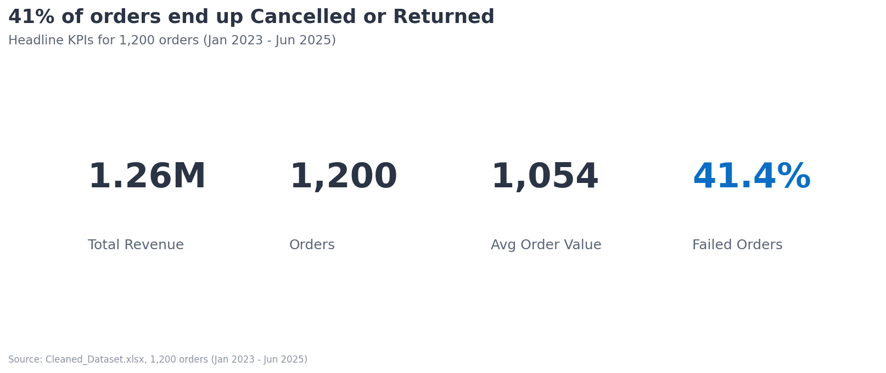
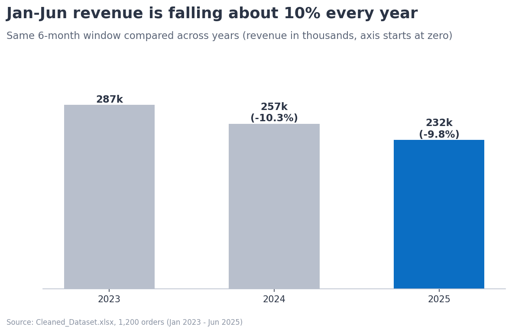
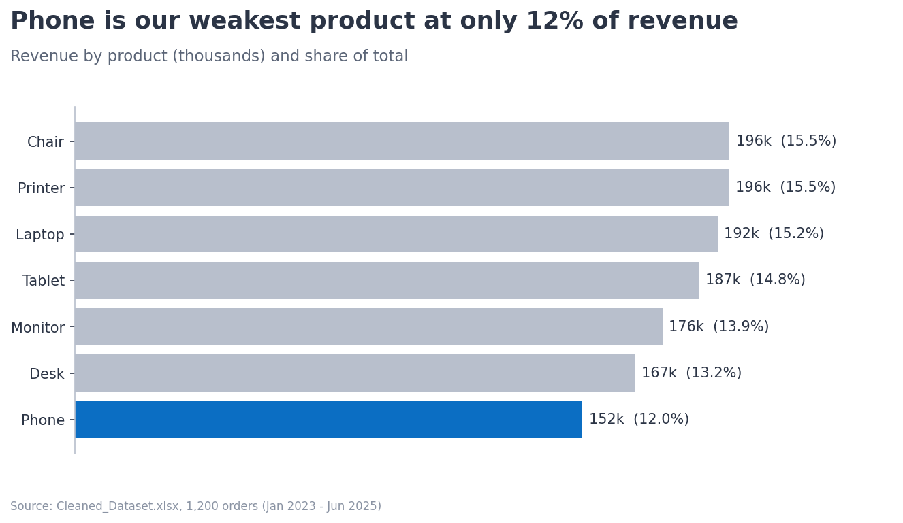
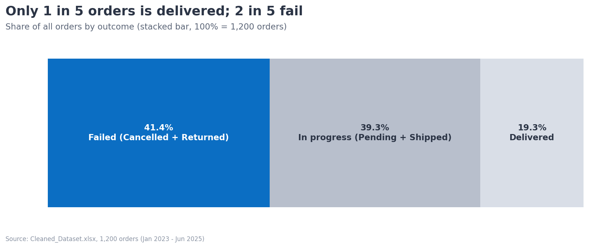

# Project 4: Data Visualization | DecodeLabs Data Analytics Internship

## Overview
Boardroom-style visual story built from 1,200 e-commerce orders (Jan 2023 - Jun 2025). Every chart has an action title, direct labels and one highlighted insight.

## Story (SCR)
- **Situation:** 1.26M revenue across 1,200 orders
- **Complication:** Revenue is falling about 10% a year and 41.4% of orders are Cancelled or Returned
- **Resolution:** Fix fulfilment and returns, build a repeat-customer plan, review the Phone category

## Design Principles Applied
- Chart type matched to the question (bar, stacked bar, scatter)
- Axes start at zero, no 3D, no chartjunk
- Direct labels instead of legends
- Grey for context, one accent color for the insight
- Action titles that state the conclusion

## Charts





## Tools
Python, Pandas, NumPy, Matplotlib

## How to Run
```bash
pip install -r requirements.txt
jupyter notebook Visualization_Project4.ipynb
```

## Author
Nasir Ali | Data Analytics Intern, DecodeLabs (Batch 2026)